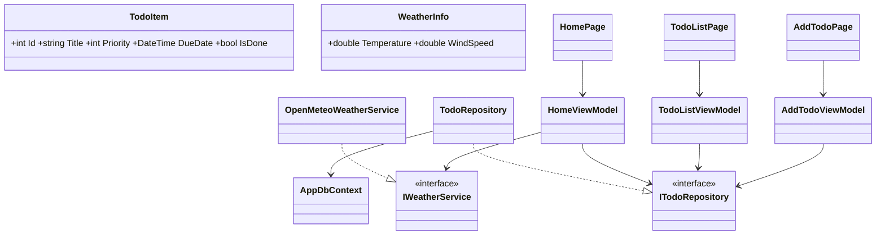

# LifeManagementApp

.NET MAUI 9 -sovellus, joka yhdistää tehtävälistan ja sään. Jos tuuli on yli 5 m/s, näytetään "🪁 Kitesurf-keli!".

## Ominaisuudet
- Etusivu: 3 tärkeintä keskeneräistä tehtävää (prioriteetti ↓, eräpäivä ↑), sää (Open-Meteo, m/s) ja kitesurf-huomio
- Tehtävälista, lajittelu prioriteetin tai eräpäivän mukaan, tehdyksi merkintä ja poisto
- Uuden tehtävän lisäys (tyhjää otsikkoa ei hyväksytä)
- Tallennus SQLiteen (EF Core Code First)
- Virheenkäsittely: ei verkkoa -> ilmoitus, lataustila näkyy

## Ajo-ohje
1. Asenna .NET 9 SDK ja MAUI-workload (`dotnet workload install maui`)
2. Avaa projekti Visual Studiossa
3. Valitse kohde (Android-emulaattori / Windows) ja paina F5
4. Sää tarvitsee verkkoyhteyden. API-avainta ei tarvita.

## Rakenne
- Models: TodoItem, WeatherInfo
- ViewModels: HomeViewModel, TodoListViewModel, AddTodoViewModel
- Views: HomePage, TodoListPage, AddTodoPage
- Services: ITodoRepository/TodoRepository, IWeatherService/OpenMeteoWeatherService
- Data: AppDbContext

## Luokkakaavio

## Tekoälyn käyttö
Käytin Claudea pohjakoodin kirjoittamiseen. Kävin koodin läpi ja opettelin, mitä jokainen osa tekee
(MVVM, DI, EF Core, async/await, bindingit).
